# Clutter Cutter

> Note for the reviewer: my commits are a bit inconsistent, because I didn't knew you have to commit every hour or two. I commited after every feature.
> But, when some hours of my previous project got deflated because of inconsistent commits, then I got to know about that you have to do commits frequently.
> I will try my best to commit every hour or two in my future projects. So, please don't deflate hours on this project.

## What it is?
clutter-cutter is a CLI tool to organize your directories. There are multiple commands and options available to organize or clear your folders/directories.

## Tech Stack:
- Node.js for executing js/ts code.
- `commander` for parsing commands entered by user in terminal.
- `chalk` for coloring terminal outputs.
- `ora` for adding beautiful spinners/loaders during operations.
- `treeify` for displaying folder structure as a tree.
- `@inquirer/prompts` for interactive selection of files.
- `chokidar` for watching the folder and organize it in real-time whenever a new file comes.

## How to use?
There are multiple commands available.
- `clutter-cutter organize <directory-path>` for moving all the files in their respective categories.
- `clutter-cutter organize <directory-path> --dry-run` for visualizing how the folder structure would look like without performing any operation.
- `clutter-cutter organize <directory-path> --watch` keeps the process running and automatically organizes new incoming files in that directory.
- `clutter-cutter organize <directory-path> --interactive` lets users choose the files they want to organize and which ones they wanna ignore.
- `clutter-cutter undo <directory-path>` brings back previous folder structure.
- Moreover, users can also create a `.clutterrc.json` file in the directory they want to organize, to provide custom file extensions and add files they want to ignore.
- `clutter-cutter organize <directory-path> --spooky` for enabling spooky mode.

The structure of `.clutterrc.json` should be like this:
```json
{
  "categories": {
    "images": [".jpg", ".jpeg", ".png", ".gif", ".svg", ".webp"],
    "documents": [".pdf", ".docx", ".doc", ".txt", ".xlsx", ".pptx", ".csv"],
    "archives": [".zip", ".tar", ".gz", ".7z", ".rar"],
    "executables": [".exe", ".dmg", ".pkg", ".deb", ".sh"],
    "code": [".js", ".ts", ".py", ".rs", ".go"],
    "design": [".fig", ".psd", ".ai", ".sketch"]
  },
  "ignore": [
    ".DS_Store",
    "Thumbs.db",
    "node_modules"
  ]
}
```

*Note: if you don't provide directory-path, it will automatically organize the current directory.*

## Screenshots:
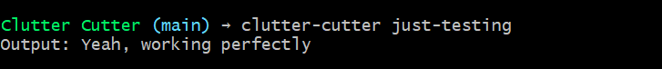
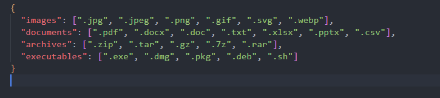
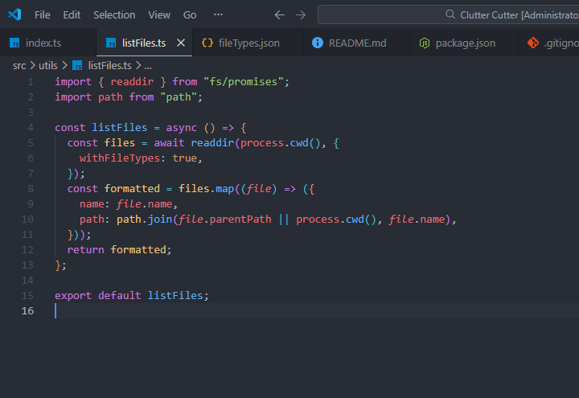
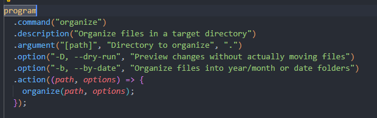
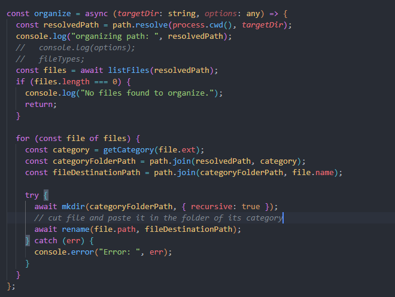
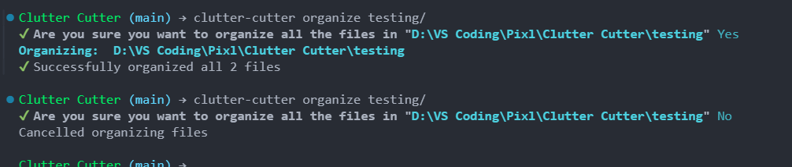
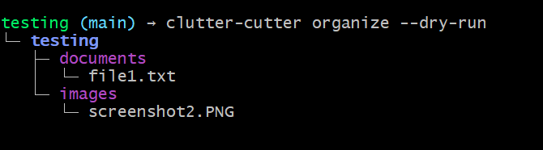
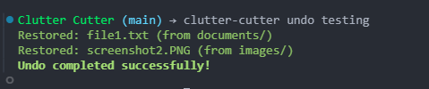
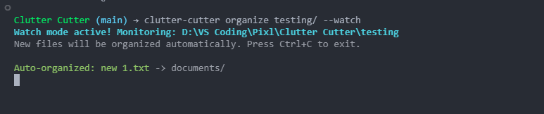
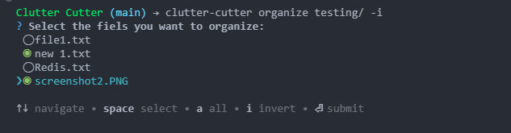
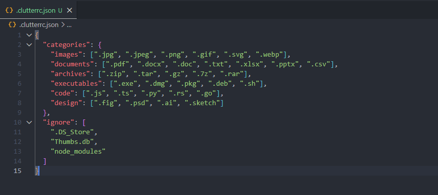